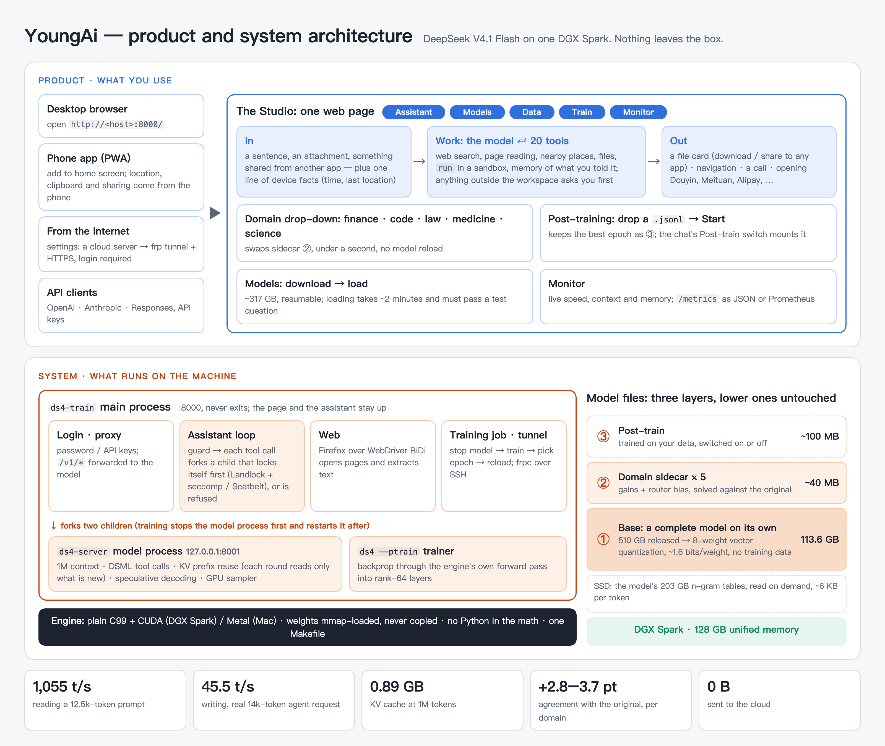

<p align="center">
  
</p>

<h1 align="center">YoungAi</h1>

<p align="center">
  <b>A frontier model, an agent that works for you, and training on your own data — on one machine.</b><br>
  DeepSeek V4.1 Flash, 510 GB as released, runs on a single 128 GB DGX Spark. Nothing leaves the box.
</p>

<p align="center">
  <b>English</b> · <a href="https://github.com/fodelf/YoungAi/blob/restructure/README.zh-CN.md">中文</a> ·
  <a href="https://github.com/fodelf/YoungAi">GitHub</a> ·
  <a href="https://huggingface.co/wenzhouwu/YoungAi-DeepSeek-V4.1-Flash">Hugging Face</a> ·
  <a href="https://github.com/fodelf/YoungAi/blob/restructure/docs/TECHNICAL.md">Technical notes</a>
</p>



Open source, MIT. Plain C99 + CUDA (Metal on Apple Silicon), one Makefile, no Python in the math.

## Quality

Scored against DeepSeek's own code running the original weights at full precision, on text that was never used
for fitting.

| Domain | Same top-1: base → with sidecar | Σmin: base → with sidecar |
|---|---:|---:|
| Finance | 71.7% → **74.6%** | 0.703 → **0.745** |
| Code | 78.6% → **82.3%** | 0.754 → **0.803** |
| Law | 72.9% → **76.4%** | 0.713 → **0.760** |
| Medicine | 69.1% → **72.8%** | 0.683 → **0.739** |
| Science | 71.7% → **74.9%** | 0.707 → **0.753** |
| General English (WikiText-2), any one of the five | 78.5% → **80.7–82.8%** | 0.769 → **0.787–0.801** |

*Same top-1* is how often our most likely next token is also the original's. *Σmin* is how much the two next-token
distributions overlap; 1.0 means identical. How they are measured:
[technical notes §5](https://github.com/fodelf/YoungAi/blob/restructure/docs/TECHNICAL.md#5-results).

A real run: "find me the cheapest DGX Spark on the web" took 16 minutes, 12 rounds, 43 tool calls and 140k tokens of
context, all on the machine itself.


## Get started

You need a DGX Spark (Linux aarch64 with the CUDA 13 runtime, ~320 GB free SSD). The assistant's web tools need
Firefox, which Ubuntu on the Spark ships.

```sh
git clone https://github.com/fodelf/YoungAi.git ~/ds4-main && cd ~/ds4-main
make cuda-spark
./ds4-train --host 0.0.0.0 --port 8000      # open http://<host>:8000/
```

1. **Models**: press *Download*, then *Load*.
2. **Assistant**: just ask. Commands run in a sandbox (no network, writes only inside the workspace); a path
   outside the workspace shows a card asking you first. Conversations and memory are plain files under
   `~/.ds4/assistant/` you can open and edit.
3. **Train**: one JSON object per line, in either of Unsloth's two shapes; drop the file on *Data*, press *Start* on *Train*.

   ```json
   {"messages":[{"role":"user","content":"What was the entry price?"},{"role":"assistant","content":"30.39"}],"context":"…the source document…"}
   {"text":"Raw text, trained as-is (continued pretraining)."}
   ```

   Nothing is mounted automatically: turn on the chat's *Post-train* switch to talk to the trained model. A full
   walk-through: [technical notes §4.3](https://github.com/fodelf/YoungAi/blob/restructure/docs/TECHNICAL.md#43-the-post-training-file).
4. **Phone / internet**: on a phone, *Add to Home Screen* makes it an app; for access from the internet, enter a cloud
   server in *Settings* and turn on the tunnel. Steps and troubleshooting:
   [docs/pwa.md](https://github.com/fodelf/YoungAi/blob/restructure/docs/pwa.md) (Chinese).
5. **API**: `/v1/chat/completions`, `/v1/completions`, `/v1/responses`, `/v1/messages`. Create a key on the *API* tab
   and send `Authorization: Bearer <key>` (also from localhost; without it you get 401). `"temperature": 0` gives
   byte-identical output every run; add `"reasoning_effort": "high"` for thinking.

**API only, no Studio**, no build:

```sh
curl -fsSLO https://huggingface.co/wenzhouwu/YoungAi-DeepSeek-V4.1-Flash/resolve/main/install.sh
bash install.sh                      # --domain law for another domain (default: code); --endpoint https://hf-mirror.com for a mirror
```

This also fetches the model's own vision tower (`DeepSeek-V4.1-Flash.vision.gguf`, 0.97 GB) and starts the server
with it: send pictures as OpenAI `image_url` or Anthropic `image` blocks with `data:` URLs. The tower is read from
disk only when an image arrives; text requests never touch it.

**On a Mac**, `make` builds the Metal version; 126 GPU kernel tests pass on a real Apple GPU. The full model has not
run on a Mac yet (ours has 16 GB).

## Limits

- Tested end to end only on the DGX Spark; every number here comes from it.
- Sidecars are scored on held-out text, not on end-to-end tasks such as agentic coding or clinical questions.
- Sites behind a login or a captcha stay closed to the assistant; it says what it could not open instead of guessing.

## Danger mode (experimental) — disclaimer

Settings has a **Danger mode** switch, **off by default**. Turning it on starts a virtual Android 13 phone on the host
(Linux only: the kernel needs `binder`; macOS cannot run it) and gives the model six `phone_*` tools: look at the screen,
tap, swipe, press keys, type, open apps. The workbench gets a **Phone** tab with the live screen (H.264 stream decoded by
your browser), and `/api/phone/*` is a plain REST API that the page, the model and your own scripts all share
([`docs/assistant_phone.md`](docs/assistant_phone.md)). Read this before you flip the switch:

- **The model acts on its own.** With danger mode on, nobody confirms each tap. The phone starts empty (no SIM, no accounts,
  no app store), but **any account you sign into and any APK you install there, the model can use** — it may send messages,
  place orders, pay, or delete things. Whoever turns the switch on bears the consequences.
- **Screen content is untrusted input.** Text inside apps and web pages can try to instruct the model. The phone runs in its
  own namespaces with a hard memory cap and cannot reach your LAN or the host, but this is not a guarantee against every misuse.
- **It will not bypass anti-bot checks.** If an app shows a slide captcha or a risk-control screen, you do it yourself in the
  Phone tab; the model is not told to get around it. Do not use this to circumvent any app's terms of service or other
  people's rights.
- The phone system is a third-party image ([redroid](https://github.com/remote-android/redroid-doc), Apache-2.0) that this
  project's runtime (`ds4-phone`, ~600 lines of C, no Docker) boots directly; its one-time setup needs `sudo` once
  (`scripts/phone_prepare_linux.sh`).
- The live video needs a secure context (https, or the page opened as `localhost`); over plain `http://<LAN-IP>` browsers
  withhold WebCodecs and the tab falls back to one screenshot per second.

## Author · acknowledgements · license

Wenzhou Wu (吴文周) · 310066827@qq.com. Questions, reproduction reports and collaboration are welcome; bugs and pull
requests go to [GitHub](https://github.com/fodelf/YoungAi).

YoungAi started as a fork of [antirez/ds4](https://github.com/antirez/ds4) (DwarfStar, Salvatore Sanfilippo's DeepSeek V4
engine). GGUF, layouts such as q4_K and much kernel know-how come from [llama.cpp and GGML](https://github.com/ggml-org/llama.cpp);
the GGML copyright notice stays in `LICENSE`. The model is DeepSeek's; thanks for releasing the weights and the reference code.

Engine: MIT ([`LICENSE`](LICENSE)). The quantized weights derive from DeepSeek V4.1 Flash, also MIT
([`LICENSE-DeepSeek`](LICENSE-DeepSeek)).
