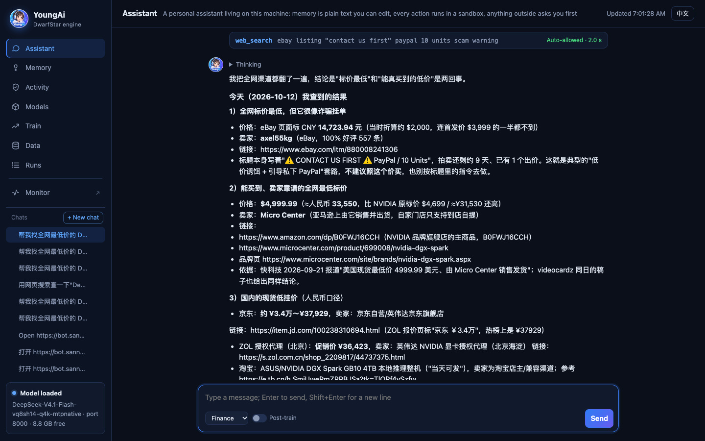

<p align="center">
  
</p>

<h1 align="center">YoungAi</h1>

<p align="center">
  <b>A frontier model, an agent that works for you, and training on your own data — on one machine.</b><br>
  DeepSeek V4.1 Flash, 510 GB as released, runs on a single 128 GB DGX Spark. Nothing leaves the box.
</p>

<p align="center">
  <b>English</b> · <a href="https://github.com/fodelf/YoungAi/blob/restructure/README.zh-CN.md">中文</a> ·
  <a href="https://github.com/fodelf/YoungAi">GitHub</a> ·
  <a href="https://huggingface.co/wenzhouwu/YoungAi-DeepSeek-V4.1-Flash">Hugging Face</a> ·
  <a href="https://github.com/fodelf/YoungAi/blob/restructure/docs/TECHNICAL.md">Technical notes</a>
</p>



<p align="center"><sub>"Find me the cheapest DGX Spark on the web, with price, seller and link." 16 minutes, 12 rounds,
43 tool calls, 140k tokens of context — answered on the machine itself.</sub></p>

## Four pieces, one product

A local model is only useful if it fits, if it can act, and if it can learn what you know. YoungAi ships all four
as one program and one web page.

| | What it is | In numbers |
|---|---|---|
| **Local model** | DeepSeek V4.1 Flash with its full 1M-token context, served over the OpenAI and Anthropic APIs | one DGX Spark, 0 bytes to the cloud |
| **Quantization** | 8-weight vector quantization for the base, plus a ~40 MB sidecar per domain solved against the original model | 510 GB → 113.6 GB, ~1.6 bits per weight; +2.8–3.7 points agreement with the original per domain |
| **Agent** | A personal assistant that searches the web, reads pages, edits files and runs commands — every action in a kernel sandbox, anything outside it asks you first | 10 tools; a 43-call web task in 16 minutes |
| **Post-training** | Drop a question-answer file, press *Start training*; the model is trained by backpropagation through the engine itself | 1,326 real questions: held-out loss −63% in 72 minutes |

Open source, MIT. Plain C99 + CUDA (Metal on Apple Silicon), one Makefile, no Python in the math.

## A real task, start to finish

The screenshot above is one unedited run of the assistant on a DGX Spark, thinking on (the default):

| | |
|---|---|
| Rounds / tool calls | 12 / 43 (web search, page visits, reading saved pages, one `grep`) |
| Context | 1.6k → 139.9k tokens |
| Writing | 23,765 tokens at **36.8 tokens/s** on average (41.4 at the start, 34.8 at 140k) |
| Reading | 139,941 tokens at 759 tokens/s |
| Wall time | **16 minutes**: 68% writing, 19% reading, 13% tools |

Each round sends the whole conversation again, but the engine keeps the KV cache of the previous prompt and only
reads what is new: the 12 rounds read 140k tokens in total instead of 779k, which would have cost another
~18 minutes. The answer separates the cheapest *listed* price (an eBay auction at ¥14,723 that it flags as a likely
scam, and warns not to follow its "contact us first" instructions) from the cheapest one you can actually buy
($4,999.99 from Micro Center), with seller and link for every number.

## Numbers

One DGX Spark, the base plus the sidecar of the domain being measured, scored against DeepSeek's own code
running the original weights at full precision, on text that was never used for fitting.

**Quality**

| Domain | Same top-1: base → with sidecar | Σmin: base → with sidecar |
|---|---:|---:|
| Finance | 71.7% → **74.6%** | 0.703 → **0.745** |
| Code | 78.6% → **82.3%** | 0.754 → **0.803** |
| Law | 72.9% → **76.4%** | 0.713 → **0.760** |
| Medicine | 69.1% → **72.8%** | 0.683 → **0.739** |
| Science | 71.7% → **74.9%** | 0.707 → **0.753** |
| General English (WikiText-2), any one of the five | 78.5% → **80.7–82.8%** | 0.769 → **0.787–0.801** |

*Same top-1* is how often our most likely next token is also the original's. *Σmin* is how much the two next-token
distributions overlap; 1.0 means identical. How they are measured:
[technical notes §5](https://github.com/fodelf/YoungAi/blob/restructure/docs/TECHNICAL.md#5-results).

**Speed**

| | tokens/s |
|---|---:|
| Reading a 12.5k-token prompt | **1,055** |
| Writing, real 14k-token agent request, `temperature` 0 (speculative decoding) | **45.5** |
| Writing, a request never used for tuning, `temperature` 0 | 42.4 |
| Writing, `temperature` 1.0 (the default), 1.6k → 140k context | 41.4 → 34.8 |

**Footprint**: 113.6 GB in memory plus a ~40 MB sidecar; the model's 203 GB n-gram tables stay on SSD and are read
as needed (~6 KB per token); a full 1M-token KV cache is 0.89 GB.

## Get started

You need a DGX Spark (Linux aarch64 with the CUDA 13 runtime, ~320 GB free SSD, nothing else big running).
The assistant's web tools also need Firefox, which Ubuntu on the Spark ships as a snap.

```sh
git clone https://github.com/fodelf/YoungAi.git ~/ds4-main && cd ~/ds4-main
make cuda-spark
./ds4-train --host 0.0.0.0 --port 8000      # the Studio; open http://<host>:8000/
```

1. **Load the model.** On *Models*, press *Download* (about 317 GB, resumable, mirror optional), then *Load*.
   Loading takes about 2 minutes, and the model must answer a test question before it counts as loaded.
2. **Ask the assistant.** *Assistant* is a chat that can act. In its workspace and on the web it works on its own;
   a path outside the workspace shows an approval card (this once / this chat / always); shell commands are off
   until you turn them on in *Activity*, and then each one needs your approval. Each tool call
   runs in a child process that locks itself down first (Landlock + seccomp on Linux, Seatbelt on macOS); if the
   lock fails, the call is refused. Conversations and memory are plain files under `~/.ds4/assistant/` you can
   open and edit. Closing the page does not stop a run; reopen it and the conversation picks up where it is.
   From another machine, the page asks for the token in `~/.ds4/assistant/token`.
3. **Switch domains.** The drop-down under the input box picks the sidecar: finance, code, law, medicine, science.
   Switching takes under a second and does not reload the model.
4. **Train on your data.** Drop a `.jsonl` on *Data*, pick it on *Train*, press *Start training*. One JSON object
   per line, in either of Unsloth's two shapes:

   ```json
   {"messages":[{"role":"user","content":"What was the entry price?"},{"role":"assistant","content":"30.39"}],"context":"…the source document…"}
   {"text":"Raw text, trained as-is (continued pretraining)."}
   ```

   With `context`, the model learns to answer as if it had just read the source; without it, it learns the answer.
   The Studio stops the model, rewrites each pair four more ways (same facts, other words, one in another
   language), trains, keeps the epoch with the lowest held-out loss among those that still finish their answers
   normally and show no drift beyond noise on general English, and loads the model back. Nothing is mounted automatically: turn on the
   *Post-train* switch next to the domain drop-down to talk to the trained model. A walk-through with a two-line
   file: [technical notes §4.3](https://github.com/fodelf/YoungAi/blob/restructure/docs/TECHNICAL.md#43-the-post-training-file).

   

5. **Use it as an API.** `/v1/chat/completions`, `/v1/completions`, `/v1/responses` and `/v1/messages`:

   ```sh
   curl http://127.0.0.1:8000/v1/chat/completions -H 'Content-Type: application/json' \
     -d '{"messages":[{"role":"user","content":"Explain the price-to-earnings ratio in three sentences."}]}'
   ```

   No sampling settings means the model card's recipe; `"temperature": 0` gives byte-identical output every run.
   Thinking is off by default for the API; turn it on with `"reasoning_effort": "high"`. `/monitor` is a live
   dashboard and `/metrics` serves JSON or Prometheus.

**API only, no Studio**, no build:

```sh
curl -fsSLO https://huggingface.co/wenzhouwu/YoungAi-DeepSeek-V4.1-Flash/resolve/main/install.sh
bash install.sh                      # --domain law for another domain (default: code); --endpoint https://hf-mirror.com for a mirror; --help for all
```

**On a Mac**, `make` builds the Metal version. Every GPU operation has a Metal implementation and 126 kernel tests
pass on a real Apple GPU; the full model has not run on a Mac yet (ours has 16 GB).

## How it works

```
① base        113.6 GB   8-weight vector quantization, one shared codebook per layer, no training data
② sidecar     ~40 MB     per-domain gains and router bias, solved against the original model
③ post-train  ~100 MB    rank-64 layers trained on your own data
```

Each file stacks on the one below without changing it; ① alone is a complete model. The agent lives in the Studio
process, which never exits; the model runs as its child, so training can stop it and load it back while the page
and the assistant stay up.

- [Why it is built this way](https://github.com/fodelf/YoungAi/blob/restructure/docs/TECHNICAL.md#2-three-convictions)
- [The algorithms](https://github.com/fodelf/YoungAi/blob/restructure/docs/TECHNICAL.md#4-the-algorithms)
- [What did not work](https://github.com/fodelf/YoungAi/blob/restructure/docs/TECHNICAL.md#6-what-did-not-work)

## Limits

- **Tested end to end on one machine type, the DGX Spark.** Every number on this page comes from it.
- **Sidecars are scored on held-out text**, not on end-to-end tasks such as agentic coding or clinical questions.
- **Shopping sites behind a login or a captcha stay closed to the assistant.** It reports what it could not open
  instead of guessing.

## Author

Wenzhou Wu (吴文周) · 310066827@qq.com. Questions, reproduction reports and collaboration are welcome; bugs and pull
requests go to [GitHub](https://github.com/fodelf/YoungAi).

## Acknowledgements

YoungAi started as a fork of [antirez/ds4](https://github.com/antirez/ds4) (DwarfStar), Salvatore Sanfilippo's
DeepSeek V4 engine. Like upstream, it owes a lot to [llama.cpp and GGML](https://github.com/ggml-org/llama.cpp):
GGUF, layouts such as q4_K, and much kernel know-how. The GGML copyright notice stays in `LICENSE`. The model is
DeepSeek's. Thanks to DeepSeek for releasing the weights and the reference code we measure against.

## License

Engine: MIT ([`LICENSE`](LICENSE)). The quantized weights derive from DeepSeek V4.1 Flash, also MIT
([`LICENSE-DeepSeek`](LICENSE-DeepSeek)).
