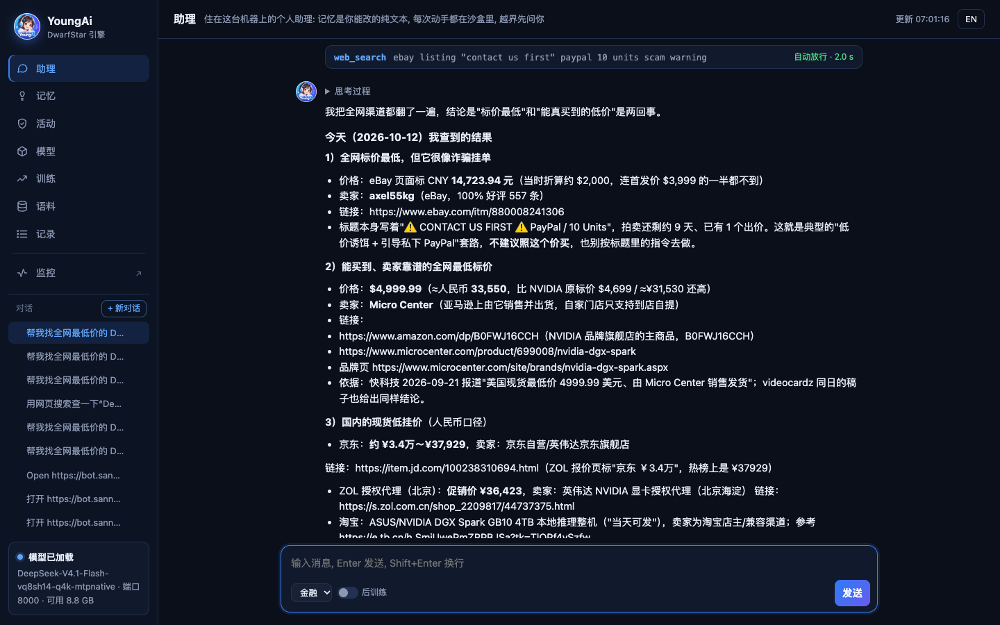

<p align="center">
  
</p>

<h1 align="center">YoungAi</h1>

<p align="center">
  <b>一台机器，装下前沿大模型、替你干活的 Agent、用你自己数据做的后训练。</b><br>
  官方权重 510 GB 的 DeepSeek V4.1 Flash，跑在一台 128 GB 的 DGX Spark 上，数据不出机器。
</p>

<p align="center">
  <a href="https://github.com/fodelf/YoungAi/blob/restructure/README.md">English</a> · <b>中文</b> ·
  <a href="https://github.com/fodelf/YoungAi">GitHub</a> ·
  <a href="https://huggingface.co/wenzhouwu/YoungAi-DeepSeek-V4.1-Flash">Hugging Face</a> ·
  <a href="https://github.com/fodelf/YoungAi/blob/restructure/docs/TECHNICAL.zh-CN.md">技术细节</a>
</p>


开源，MIT 协议。纯 C99 + CUDA（Apple Silicon 用 Metal），一个 Makefile，数值计算里没有 Python。

## 质量

对照的是 DeepSeek 官方代码用原始权重全精度跑出来的结果，测试文本从没用来拟合过。

| 领域 | top-1 一致率：裸基座 → 挂侧车 | Σmin：裸基座 → 挂侧车 |
|---|---:|---:|
| 金融 | 71.7% → **74.6%** | 0.703 → **0.745** |
| 编程 | 78.6% → **82.3%** | 0.754 → **0.803** |
| 法律 | 72.9% → **76.4%** | 0.713 → **0.760** |
| 医疗 | 69.1% → **72.8%** | 0.683 → **0.739** |
| 科研 | 71.7% → **74.9%** | 0.707 → **0.753** |
| 通用英文（WikiText-2），五个侧车挂任意一个 | 78.5% → **80.7–82.8%** | 0.769 → **0.787–0.801** |

*top-1 一致率*：我们最可能写的下一个字，有多少比例和原模型一样。*Σmin*：两边下一个字的概率分布重叠了多少，
1.0 就是一模一样。测法见[技术细节第五章](https://github.com/fodelf/YoungAi/blob/restructure/docs/TECHNICAL.zh-CN.md#五实测结果)。

实拍：让助理"找全网最低价的 DGX Spark"，16 分钟、12 轮、43 次工具调用、上下文涨到 14 万 token，全在这台机器上跑完。



## 上手

需要一台 DGX Spark（Linux aarch64 + CUDA 13 运行库，SSD 空闲约 320 GB）。助理联网要火狐，Spark 上的 Ubuntu 自带。

```sh
git clone https://github.com/fodelf/YoungAi.git ~/ds4-main && cd ~/ds4-main
make cuda-spark
./ds4-train --host 0.0.0.0 --port 8000      # 浏览器打开 http://主机:8000/
```

1. **"模型"页**点"下载"再点"加载"。
2. **"助理"页**直接提问。命令在沙盒里跑（没网络、只能写工作区）；碰工作区以外的路径会弹卡片问你。
   对话和记忆是 `~/.ds4/assistant/` 下的纯文本，能直接打开改。
3. **训练**：一行一个 JSON，两种写法，和 Unsloth 一一对应；"语料"页拖进去，"训练"页点开始。

   ```json
   {"messages":[{"role":"user","content":"入场价是多少？"},{"role":"assistant","content":"30.39"}],"context":"……原文材料……"}
   {"text":"一段原文，原样训（续训）。"}
   ```

   训完不会自动挂上，聊天页打开"后训练"开关才用训练后的模型。完整走一遍见[技术细节 4.3](https://github.com/fodelf/YoungAi/blob/restructure/docs/TECHNICAL.zh-CN.md#43-后训练文件)。
4. **手机 / 外网**：手机打开后"添加到主屏幕"就是 App；要从外网访问，在"设置"里填一台云服务器，开穿透，
   步骤和排错见 [docs/pwa.md](https://github.com/fodelf/YoungAi/blob/restructure/docs/pwa.md)。
5. **当 API 用**：`/v1/chat/completions`、`/v1/completions`、`/v1/responses`、`/v1/messages`。传 `"temperature": 0`
   每次输出逐字节相同；要思考加 `"reasoning_effort": "high"`。

**只要 API、不要工作台**，不用编译：

```sh
curl -fsSLO https://huggingface.co/wenzhouwu/YoungAi-DeepSeek-V4.1-Flash/resolve/main/install.sh
bash install.sh                      # 默认编程侧车，--domain law 换领域；--endpoint https://hf-mirror.com 走镜像
```

**Mac**：`make` 编出 Metal 版，126 项 GPU 核测试在真 Apple GPU 上全过；整模型还没在 Mac 上跑过（手上的 Mac 只有 16 GB）。

## 局限

- 只在 DGX Spark 上端到端验过，本页数字都来自它。
- 侧车只在留出文本上评过分，还没在端到端任务（Agent 式编程、临床问答等）上评过。
- 要登录或有验证码的网站，助理打不开；它会说哪些没打开，不会去猜。

## 作者 · 致谢 · 许可证

吴文周 · 310066827@qq.com。欢迎来信交流、反馈复现结果或谈合作；Bug 和 PR 提到 [GitHub](https://github.com/fodelf/YoungAi)。

本项目起步于 [antirez/ds4](https://github.com/antirez/ds4)（DwarfStar，Salvatore Sanfilippo 为 DeepSeek V4 写的推理引擎）
的分叉；GGUF、q4_K 等布局和大量核经验来自 [llama.cpp 与 GGML](https://github.com/ggml-org/llama.cpp)，GGML 的版权声明
保留在 `LICENSE`。模型属于 DeepSeek，感谢公开权重和参考代码。

引擎 MIT（[`LICENSE`](LICENSE)）；量化权重派生自 DeepSeek V4.1 Flash，同为 MIT（[`LICENSE-DeepSeek`](LICENSE-DeepSeek)）。
