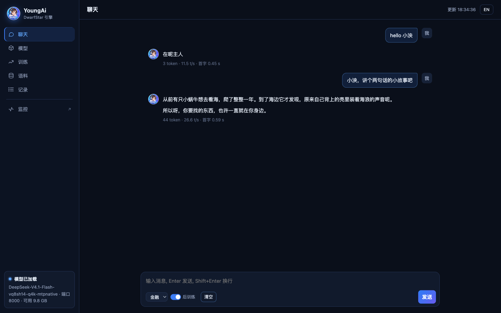

<p align="center">
  
</p>

<h1 align="center">YoungAi</h1>

<p align="center">
  <b>DeepSeek V4.1 Flash —— 官方权重 510 GB 的模型 —— 跑在一台 128 GB 的机器上。</b><br>
  聊天、监控、用你自己的数据训练，全在一个页面里。
</p>

<p align="center">
  <a href="https://github.com/fodelf/YoungAi/blob/restructure/README.md">English</a> · <b>中文</b> ·
  <a href="https://github.com/fodelf/YoungAi">GitHub</a> ·
  <a href="https://huggingface.co/wenzhouwu/YoungAi-DeepSeek-V4.1-Flash">Hugging Face</a> ·
  <a href="https://github.com/fodelf/YoungAi/blob/restructure/docs/TECHNICAL.zh-CN.md">技术细节</a>
</p>


## 你能得到什么

- **整个模型装进一台机器。** 113.6 GB，一台 NVIDIA DGX Spark，1M token 上下文，数据不出机器。
- **快到能干活。** 真实 14k token 的 Agent 请求，写答案 45 token/s；读 12.5k token 的提示 1,055 token/s。
- **离原模型很近。** 每个领域一个约 40 MB 的侧车，金融、编程、法律、医疗、科研和原模型的一致率各提 2.8–3.7
  个点，通用文本也跟着变好，不是变差。聊天时随时切领域，不到 1 秒，不用重装模型。
- **用你自己的数据教它。** 上传一份问答文件，点"开始训练"。1,326 道真实题目：72 分钟，留出损失降 63%，
  通用能力检查通过。数据全程留在本机。
- **开源，纯 C。** MIT 协议。C99 + CUDA（Apple Silicon 用 Metal），一个 Makefile，数值计算里没有 Python。

## 数字

一台 DGX Spark，基座 + 被测领域自己的侧车。对照的是 DeepSeek 官方代码用原始权重全精度跑出来的结果，测试文本
从没用来拟合过。

**质量**

| 领域 | top-1 一致率：裸基座 → 挂侧车 | Σmin：裸基座 → 挂侧车 |
|---|---:|---:|
| 金融 | 71.7% → **74.6%** | 0.703 → **0.745** |
| 编程 | 78.6% → **82.3%** | 0.754 → **0.803** |
| 法律 | 72.9% → **76.4%** | 0.713 → **0.760** |
| 医疗 | 69.1% → **72.8%** | 0.683 → **0.739** |
| 科研 | 71.7% → **74.9%** | 0.707 → **0.753** |
| 通用英文（WikiText-2），五个侧车挂任意一个 | 78.5% → **80.7–82.8%** | 0.769 → **0.787–0.801** |

*top-1 一致率*：我们最可能写的下一个字，有多少比例和原模型一样。*Σmin*：两边下一个字的概率分布重叠了多少，
1.0 就是一模一样。完整表格和测法见[技术细节第五章](https://github.com/fodelf/YoungAi/blob/restructure/docs/TECHNICAL.zh-CN.md#五实测结果)。

**速度**

| | token/s |
|---|---:|
| 读 12.5k token 的提示 | **1,055** |
| 走服务端读 106.7k token 的提示 | 671 |
| 写答案，真实 14k token Agent 请求，`temperature` 0（投机解码） | **45.5** |
| 写答案，一条调参时没碰过的请求，`temperature` 0 | 42.4 |
| 写答案，`temperature` 1.0（聊天默认） | 34–37 |

**占用**

| | |
|---|---|
| 内存 | 113.6 GB 模型 + 约 40 MB 侧车，折合每个权重约 1.6 bit |
| SSD 上原样读取 | 模型自带的 203 GB n-gram 记忆表，每个 token 读约 6 KB |
| 上下文 | 1M token；1M 满载的 KV 缓存只有 0.89 GB |

## 使用方式

需要一台 DGX Spark（Linux aarch64 + CUDA 13 运行库，SSD 空闲约 320 GB，别跑其他大任务）。

**1. 编译**

```sh
git clone https://github.com/fodelf/YoungAi.git ~/ds4-main && cd ~/ds4-main
make cuda-spark
```

**2. 打开工作台**

```sh
./ds4-train --host 0.0.0.0 --port 8000
```

浏览器打开 `http://主机:8000/`。这时还没装模型，页面照样能开。

**3. 下载并加载模型**

进"模型"页，点"下载"：约 317 GB，可以选国内镜像，断了再点一次就从断点接着下。已经有官方权重第 47、48
两个分片的，把目录填进去，省掉其中 203 GB。下完在"本机模型"里点"加载"，大约 2 分钟；装完会先自测一句问答，
答得出来才算装好。

**4. 聊天**

回到"聊天"页。输入框左下角的下拉框切换领域：金融、编程、法律、医疗、科研。切换不用重装模型，不到 1 秒；
正在回答时切，会等这条答完再生效。旁边的"后训练"勾选框挂上或卸下你自己训出来的那一层（第 5 步），训过才会出现。

**5. 用自己的数据训练**

"语料"页拖进一个 `.jsonl`，"训练"页选它，点"开始训练"。训练要用模型正在占的那份内存，工作台会自己停模型、
开训、训完再把模型装回来，页面全程不断。开训前模型会把你文件里的每组问答再改写成 4 组——同样的事实、不同的说法，
其中一组换成另一种语言——这样写进权重的是事实本身而不是某一种措辞；改写结果以同样的 jsonl 存在你的文件旁边，
可以直接看。选轮只看三件事：留出损失比训前低、回答还能正常收口、通用英文（WikiText-2）没有可测量的退——满足的轮里
取留出损失最低的那一轮，落盘并关联训练时装着的那个领域侧车。模型装回来还是训前那套，不会自动挂上。回到聊天页，
切到那个领域、打开"后训练"开关，就是训练后的模型；关掉开关或切到别的领域就卸下。一轮都不满足的那次不会出现在开关里。
18 行料训 1 轮的冒烟，连改写和检查一起约 10 分钟。实测：24 行料（12 条事实、每条两种问法），训出来的层对第三种没见过的
问法答对 11/12（训前 0/12），8 道常识题的回答与训前一致。

训练数据一行一个 JSON，两种写法，和 Unsloth 一一对应：

```json
{"messages":[{"role":"user","content":"入场价是多少？"},{"role":"assistant","content":"30.39"}],"context":"……原文材料……"}
{"text":"一段原文，原样训（续训）。"}
```

`context` 可以不写。带上它，模型学的是"像刚读过这份材料那样回答"；不带，学的就是答案本身。

**最小例子：两行料。** 想先把整条链走一遍，存下面两行当训练料：

```json
{"messages":[{"role":"user","content":"hello 小泱"},{"role":"assistant","content":"在呢主人"}]}
{"messages":[{"role":"user","content":"小泱，讲个两句话的小故事吧"},{"role":"assistant","content":"从前有只小蜗牛想去看海，它慢慢爬了整整一年。到了海边它才发现，自己背上的壳里一直装着海浪的声音。"}]}
```

料只有几行时，再存一份同样两件事、换了问法的文件，在训练页"泛化留出(可选)"里选它：

```json
{"messages":[{"role":"user","content":"小泱你好"},{"role":"assistant","content":"在呢主人"}]}
{"messages":[{"role":"user","content":"小泱，来个超短的小故事"},{"role":"assistant","content":"从前有只小蜗牛想去看海，它慢慢爬了整整一年。到了海边它才发现，自己背上的壳里一直装着海浪的声音。"}]}
```

不给这份文件，留出损失只剩内置的通用题。训完它必然升高，这次训练会被判无效，开关里不会出现。

默认 3 轮，从停模型到装回来约 12 分钟：

| | 训前 | 训后 |
|---|---|---|
| 换问法的留出损失 | 2.82 | 0.24 |
| "hello 小泱"(温度 0) | 一段长寒暄 | 在呢主人 |
| 讲故事(温度 0) | 另编一个猫的故事 | 蜗牛故事，逐字 |
| "小泱，来个超短的小故事"(没训过的问法) | 另编一个故事 | 蜗牛故事 |
| 1+1 等于几 | 2 | 2 |

聊天页不传温度，按模型卡配方采样，"hello 小泱"逐字答"在呢主人"约六成，其余是"在呢，主人～"之类的变体。
换成"小泱你好"这个问法，选中的那轮仍是原来的寒暄。第 2 轮其实答对了这句，但选轮看的是两道留出题合计的损失，
故事那题字多、占大头，挑中了第 3 轮。



**6. 当作 API 用**

服务兼容 OpenAI 和 Anthropic 的接口：`/v1/chat/completions`、`/v1/completions`、`/v1/responses`、`/v1/messages`。

```sh
curl http://127.0.0.1:8000/v1/chat/completions -H 'Content-Type: application/json' \
  -d '{"messages":[{"role":"user","content":"用三句话解释什么是市盈率。"}]}'
```

- 不带采样参数时按模型卡的推荐配方采样。要每次输出逐字节相同，传 `"temperature": 0`。
- 默认不思考。要思考就加 `"reasoning_effort": "high"`。
- `/monitor` 是实时监控页；`/metrics` 给 JSON，也给 Prometheus 格式（vLLM 的指标名）。

**只要 API、不要工作台**：一条命令装好起服，不用编译。

```sh
curl -fsSLO https://huggingface.co/wenzhouwu/YoungAi-DeepSeek-V4.1-Flash/resolve/main/install.sh
bash install.sh                      # --domain code 换领域；--endpoint https://hf-mirror.com 走镜像；--help 看全部选项
```

**Mac**：`make` 编出 Metal 版。每个 GPU 操作都有 Metal 实现，126 项核测试在真 Apple GPU 上全过；整模型还没在
Mac 上跑过，我们手上的 Mac 只有 16 GB。

## 原理

```
① 基座      113.6 GB   每 8 个权重一起做向量量化，每层共享一个码本，不用任何训练数据
② 侧车      约 40 MB   每个领域一份的增益和路由偏置，对着原模型解出来
③ 后训练    约 100 MB  用你自己的数据训出来的小低秩层
```

上面一层叠在下面一层上，不改下面任何东西。① 单独就是一个完整的模型。

- [为什么这么设计](https://github.com/fodelf/YoungAi/blob/restructure/docs/TECHNICAL.zh-CN.md#二三个信念)
- [算法](https://github.com/fodelf/YoungAi/blob/restructure/docs/TECHNICAL.zh-CN.md#四算法)
- [没走通的路](https://github.com/fodelf/YoungAi/blob/restructure/docs/TECHNICAL.zh-CN.md#六没走通的路)

## 局限

- **只在一种机器上端到端验过：DGX Spark。** 本页所有数字都来自它。
- **侧车只在留出文本上评过分**，还没在端到端任务（Agent 式编程、临床问答等）上评过。
- **通用能力检查只带了一份判决料（WikiText-2 的 512 个 token）。** 它的参考分布要用原始权重算，所以随包提供；
  换别的判决料要有原始权重的机器。

## 作者

吴文周 · 310066827@qq.com。欢迎来信交流、反馈复现结果或谈合作；Bug 和 Pull Request 请提到
[GitHub](https://github.com/fodelf/YoungAi)。

## 致谢

本项目起步于 [antirez/ds4](https://github.com/antirez/ds4)（DwarfStar）的分叉，那是 Salvatore Sanfilippo 为
DeepSeek V4 写的推理引擎。和上游一样，我们受惠于 [llama.cpp 与 GGML](https://github.com/ggml-org/llama.cpp)：
GGUF、q4_K 这样的布局，以及大量核方面的经验都来自那里，GGML 作者的版权声明保留在 `LICENSE` 中。模型属于 DeepSeek，
感谢 DeepSeek 公开权重，以及我们用来对照的官方参考代码。

## 许可证

引擎：MIT（[`LICENSE`](LICENSE)）。量化权重派生自 DeepSeek V4.1 Flash，同为 MIT（[`LICENSE-DeepSeek`](LICENSE-DeepSeek)）。
